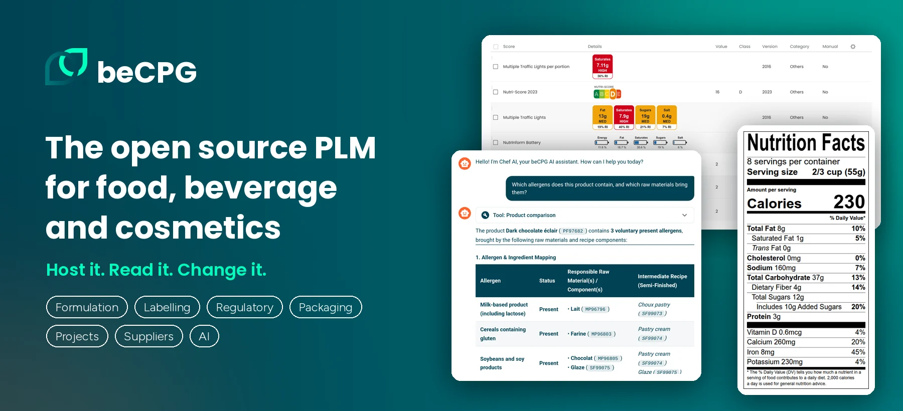
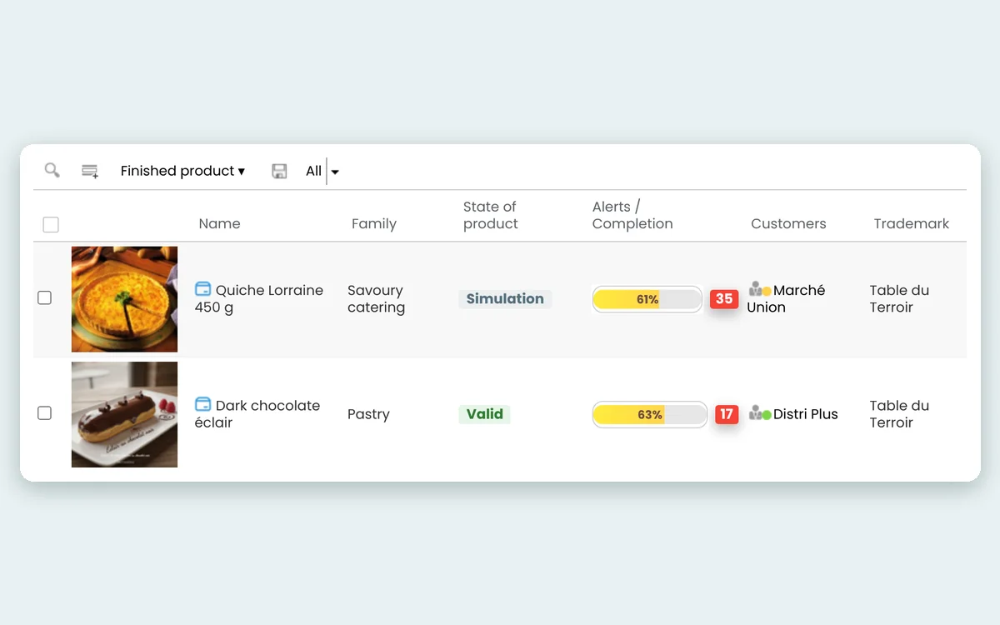
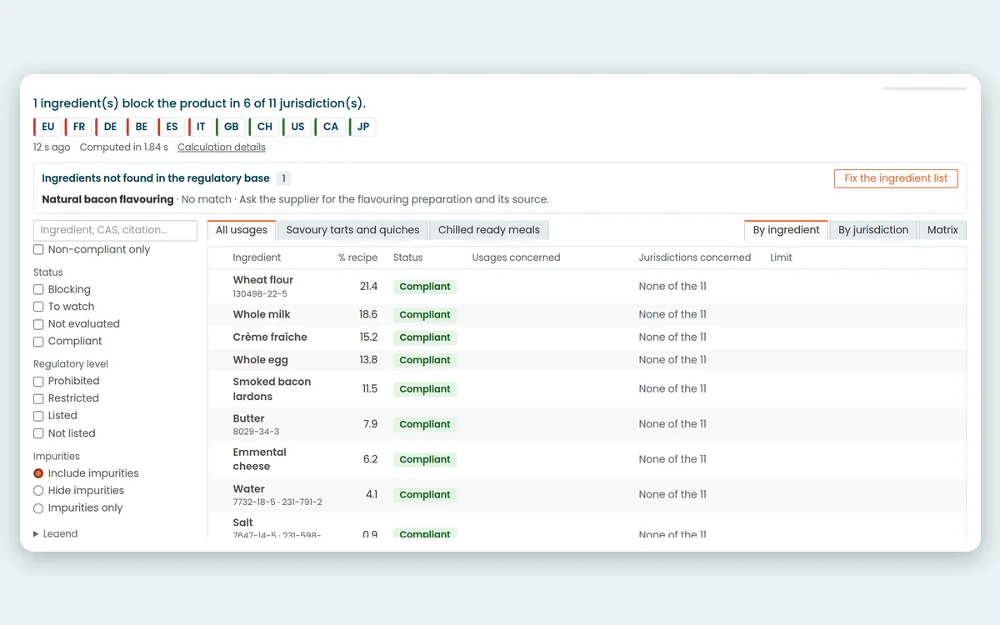
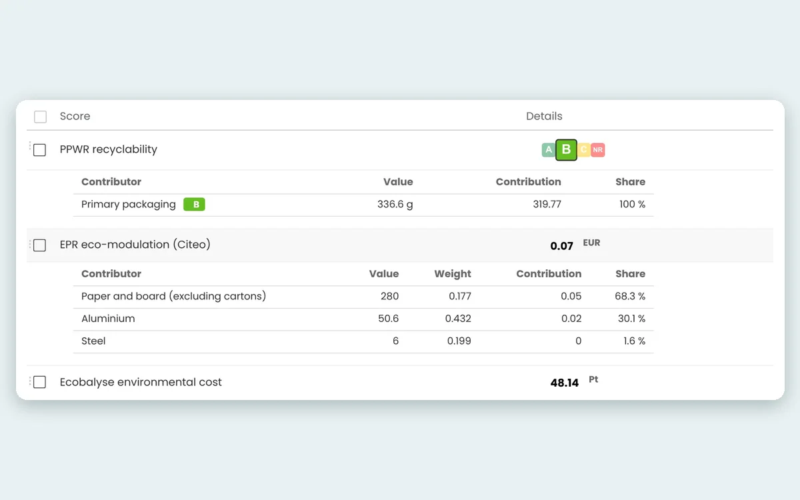
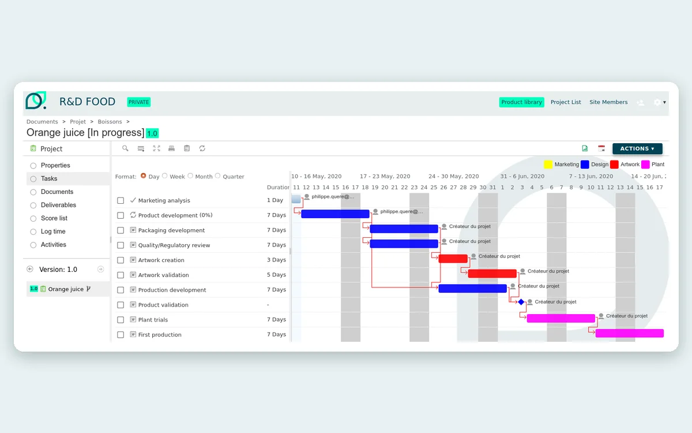
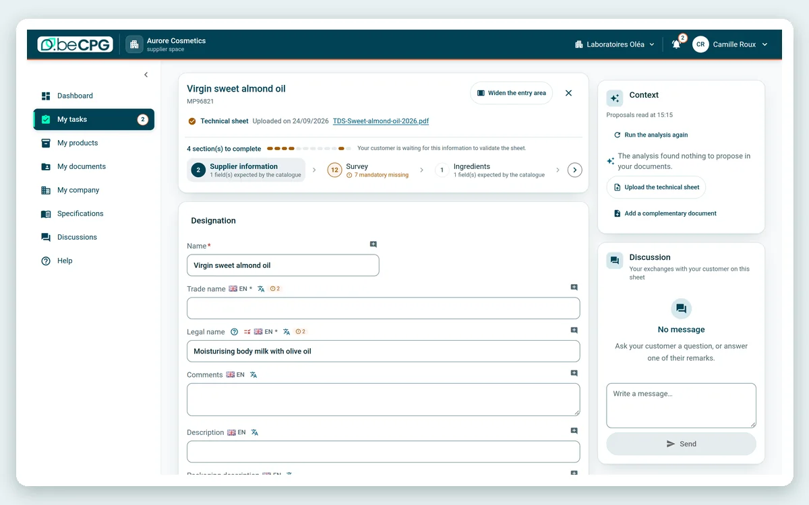
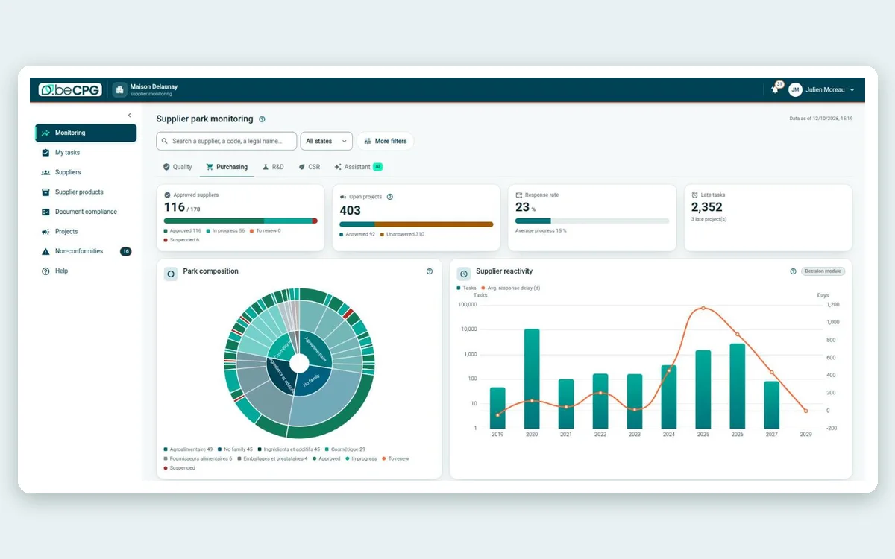

<div align="center">



[](https://www.gnu.org/licenses/lgpl-3.0)
[](https://www.becpg.net/docs/en/)
[](https://openjdk.org/projects/jdk/21/)
[](https://www.hyland.com/en/products/alfresco-platform)
[](https://maven.apache.org/)
[](docker-compose.override.yml.sample)
[](https://github.com/becpg/becpg-community/issues)
[](https://github.com/becpg/becpg-community/stargazers)
[](https://www.becpg.net/docs/en/)
[](https://www.becpg.net)

[Website](https://www.becpg.net) · [Documentation](https://www.becpg.net/docs/en/) · [Free trial](https://www.becpg.net/contact-us/#trial) · [Book a demo](https://www.becpg.net/contact-us/#demo)

</div>


---

You change one raw material in a recipe. Now the cost is different, the nutrition table is different, maybe an allergen appears, and the product may no longer be sold in three of the countries you ship to. In most companies, finding all of that out takes a week of spreadsheets and emails.

beCPG is an all-in-one PLM (Product Lifecycle Management) software for food, beverage and cosmetics. Recipes, packaging, specifications, regulatory data, projects, quality and suppliers live in one place, so the answer is recalculated the moment you save. More than 120 manufacturers use it every day, from small R&D teams to large international groups: see the [customer references](https://www.becpg.net/who-are-we/customers-references/).

This repository is its open source Community Edition.

<table>
<tr>
<td width="33%"><br><b>Product repository</b><br><sub>Every product with its state, alerts, scores and margin.</sub></td>
<td width="33%"><br><b>Regulatory view</b><br><sub>One verdict per market, and the ingredient that blocks it.</sub></td>
<td width="33%"><br><b>Packaging and eco-design</b><br><sub>PPWR grade, eco-modulation and environmental cost, with their breakdown.</sub></td>
</tr>
<tr>
<td width="33%"><br><b>Projects</b><br><sub>From brief to launch, every task scheduled and notified.</sub></td>
<td width="33%"><br><b>Supplier portal</b><br><sub>Suppliers fill in their sheets, in their language.</sub></td>
<td width="33%"><br><b>Business intelligence</b><br><sub>Your supplier park at a glance: approvals, projects, reactivity.</sub></td>
</tr>
</table>

<sub>Screenshots from a demo instance; brand, supplier and people names are fictitious.</sub>

## At a glance

| | |
| --- | --- |
| What it is | All-in-one PLM for formulated consumer goods: product data, formulation, labelling, regulatory compliance, specifications, packaging, quality, projects and supplier collaboration |
| Industries | Food and beverage, bakery and pastry, ready meals, dairy, confectionery, ingredients, food supplements, cosmetics and personal care |
| Company size | SMEs and large groups alike: multi-site, multi-brand and multi-country deployments with very large portfolios |
| Licence | Open source, GNU LGPL v3 (Community Edition); subscription for the Enterprise Edition |
| Deployment | Your own servers or any cloud with Docker or Kubernetes, or SaaS hosted on Google Cloud in Europe or the United States |
| Publisher | beCPG, Montrouge, France. Founded in 2010, open source since 2014; publisher and integrator of its own PLM |
| Current release | 26.1. One major and three minor releases a year; three major versions maintained in parallel |
| Languages | Interface translated into English, French, German, Italian, Spanish, Portuguese, Russian, Swedish, Finnish, Turkish and Japanese, and new languages can be added; product data, labels and documents in any language and regional variant (en_US, zh_CN, ar...) |
| Technology | Java 21, Spring, Alfresco, Solr, Activiti, REST API, MCP server, Docker and Kubernetes |

## Why beCPG

**Turnkey for food and cosmetics.** Formulation, labelling, regulatory compliance, packaging, specifications, quality, projects and the supplier portal are in the standard product, not in add-ons or custom development. The team behind it has worked with food and cosmetics manufacturers for more than 15 years, and regulatory updates ship in the standard releases for every customer.

**From SMEs to large groups.** A small team can start in days with the standard configuration. A group defines one configuration (data model, templates, labelling rules, specifications) and each site, brand or country sees its own products through access rights. Adding a site is a commissioning task, not a new project, and bulk operations are built for portfolios of tens of thousands of formulas.

**Sovereign by design.** The core is open source. Host it on your own servers, in your own cloud or in our SaaS; read the code to see how a value is calculated; configure most of it yourself and extend the rest; export all your data at any time. The AI module can even run on a model you host yourself, and your data is never used to train one.

**Calculations you can trust, AI that helps.** Nutrition, labelling, compliance and costs come from deterministic engines. The AI assistant searches, reads and drafts; a person accepts or rejects each proposal.

**One team.** beCPG is both publisher and integrator: the people who build the product run your project and support you afterwards.

beCPG is usually evaluated alongside Trace One (Devex), Aptean (Lascom), Centric PLM, Infor PLM for Process (Optiva), Siemens Opcenter RD&L or SAP Recipe Development. It is the only open source option among them, and it covers food and cosmetics in depth in its standard product. It is not designed for mechanical or electronic engineering driven by CAD; a discrete-manufacturing PLM fits those better.

<sub>Product names and trademarks belong to their respective owners.</sub>

## What's in it

**Product data.** Finished products, raw materials, semi-finished products, packaging, suppliers and customers, with versions, branches, change orders, effectivity dates and documents.

**Formulation.** Multi-level recipes with yields and losses, variants and trials compared side by side. Costs, nutrition, allergens and ingredient lists follow every change, and a solver looks for the cheapest recipe that still meets your constraints.

**Labelling.** Nutrition per 100 g and per serving, ingredient lists with QUID, allergens with carry-over, origins, for markets worldwide. Nutri-Score, traffic lights, NutrInform, front-of-pack warnings, US and Canadian Nutrition Facts. For cosmetics: INCI lists, fragrance allergens, the product information file and toxicology.

**Regulatory compliance.** Every ingredient checked by usage and by country, with the regulatory citation behind each status, plus SVHC and CLP calculations.

**Packaging and eco-design.** Packaging levels and palletisation, PPWR and AGEC indicators, Citeo export, life cycle assessment with the PEF method and Agribalyse, Green-Score, Planet-Score, Ecobalyse and the Green Impact Index.

**Around the product.** Customer specifications and technical sheets, quality control plans and non-conformities, NPD projects with stages, Gantt and workflows, a supplier portal with electronic signature, BI cubes.

**Integration.** REST API, bulk import from Excel and CSV, connectors for SAP S/4HANA, GS1 GDSN data pools, Salsify and Decernis, and exchanges with other ERPs, CRMs, labelling software and e-commerce sites. An MCP server lets Claude, Cursor, VS Code or your own agents use beCPG tools.

## New in 26.1

- A **regulatory view**: one verdict per market, the ingredients missing from the regulatory base, and compliance read by ingredient, by jurisdiction or as a matrix, with the citation and the limit behind each status.
- A **Scores** list for Nutri-Score, traffic lights, front-of-pack warnings and the rest, with a dashboard and a search by class. The Nutri-Score algorithm (2017 or 2023) is chosen product by product.
- **PPWR recyclability**: a grade from A to C, or not recyclable, weighted by material and packaging level, with the detail of the calculation.
- **Multi-level packaging BOMs**, so the weight and origin of each material roll up to the finished product.
- **US and Canadian Nutrition Facts** generated as print-ready vector images, in all the official formats, in English, French or both.
- A **PIF report** for cosmetics, quali-quanti formula included.
- A **new supplier portal**, where AI reads the supplier's spec sheet and proposes the values for them to check.
- **Chef AI**, the built-in assistant, and the **MCP server**.
- Alfresco 26.1 and Java 21.

## Getting started

The quickest way to see beCPG is the [30-day free trial](https://www.becpg.net/contact-us/#trial): an online instance with sample data, nothing to install.

To run the Community Edition yourself, you need Docker, Java 21 and Maven:

```bash
git clone https://github.com/becpg/becpg-community.git
cd becpg-community
cp docker-compose.override.yml.sample docker-compose.override.yml
./run.sh build_start
```

Two other open source projects are a good place to start too:

- [**beCPG starter**](https://github.com/becpg/becpg-starter) runs beCPG Community on your machine in one command, with Product Studio and an AI agent that works in beCPG through the API. If you want to build your own agents, start there.
- [**beCPG Supplier Portal**](https://github.com/becpg/becpg-supplier-portal) is the side your suppliers see: specifications, certificates, surveys and electronic signature, in their language and on their phone.

The [documentation](https://www.becpg.net/docs/en/) covers use, configuration and development.

<details>
<summary><b>Developer guide</b></summary>

### Build

```bash
./run.sh build_start
```

### Tests

Unit tests need neither a build nor a running instance:

```bash
./mvnw test -pl becpg-core -Dtest=MyClassTest
```

Integration tests run against a started instance (`./run.sh build_start`):

```bash
./mvnw test -pl becpg-integration-runner -Dtest=MyServiceIT
```

</details>

## Community or Enterprise?

Both editions share the same core. The Enterprise Edition adds what most companies need in production.

| | Community | Enterprise |
| --- | --- | --- |
| Licence | GNU LGPL v3, free | Subscription |
| Hosting | You build and run it with Docker | Our SaaS (EU or US) or your own servers |
| Updates | Community releases | Stable branch and patches |
| Regulatory module | Not included | Compliance by country and usage, regulatory view |
| AI module | Not included | Chef AI, AI pre-filling in the supplier portal, MCP server |
| BI and reporting | Community reporting engine | Full BI and reporting |
| Food and cosmetics data | You configure it | Preconfigured |
| Support | GitHub | The beCPG team, with implementation and training |

## Rolling it out

What works, from our projects in food and cosmetics:

1. **Start with your own products.** Build 3 to 5 reference products in the first workshop, with their raw materials, packaging and documents, and check the calculations together.
2. **Go in phases**, each one delivered to a test environment and signed off before the next: first the product repository, formulation and specifications; then projects, supplier portal and ERP interface; then GS1 and retailer catalogues, PIM and quality.
3. **Design for the group, roll out at your pace**: all at once, by range or by country, with data migrated in one go or site by site.
4. **Plan the data import early**, with a named owner. Cleaning the content is usually the longest part.
5. **Train your administrators.** Around 90% of the configuration is in their hands once the project ends.

beCPG runs its projects directly and can work alongside your integrator: see our [partners](https://www.becpg.net/who-are-we/partners/) and the [implementation page](https://www.becpg.net/who-are-we/plm-implementation/).

## Contributing

Found a bug, want to propose a change or translate beCPG into your language? Open an issue or a pull request on [GitHub](https://github.com/becpg/becpg-community); the team that builds beCPG reviews every contribution. Please read the [contributing guidelines](CONTRIBUTING.md) and the [code of conduct](CODE_OF_CONDUCT.md) first, and report security issues as described in the [security policy](SECURITY.md).

Questions about your own products or markets? [Talk to us](https://www.becpg.net/contact-us/#demo), ideally with one of your recipes in hand.
